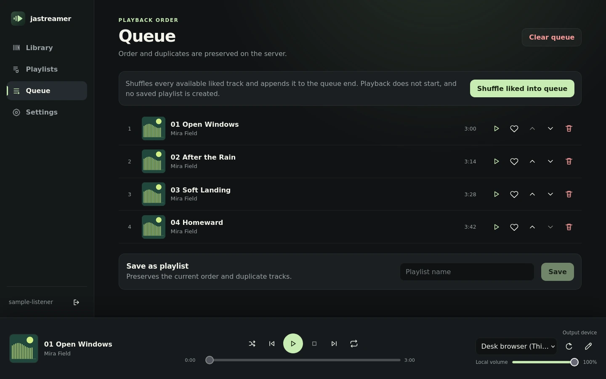
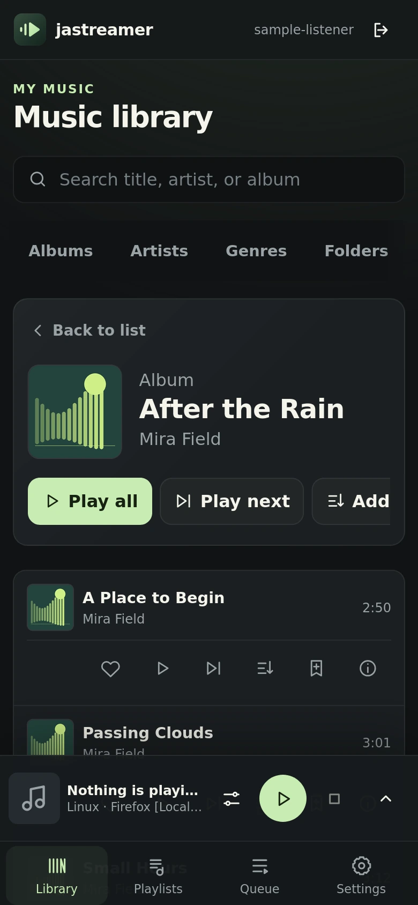

# jastreamer

[](https://github.com/furyheimdall/jastreamer/actions/workflows/ci.yml)
[](https://go.dev/)
[](https://www.typescriptlang.org/)
[](https://www.python.org/)
[](LICENSE)


**어느 화면에서든 재생하고, 원하는 곳에서 듣습니다.** jastreamer는 홈 네트워크용 자체 호스팅 음악 서버입니다. 컴퓨터나 휴대전화에서 조작하는 공용 대기열 하나를 브라우저, UPnP/DLNA, Google Cast, AirPlay 또는 USB DAC으로 재생합니다.

<p>
  
  
</p>

## 문서

| 주제 | 한국어 | English |
| --- | --- | --- |
| 제품 소개 사이트 | [한국어](https://furyheimdall.github.io/jastreamer/ko/) | [English](https://furyheimdall.github.io/jastreamer/) |
| 설치·업데이트·복구 | [INSTALL.ko.md](INSTALL.ko.md) | [INSTALL.md](INSTALL.md) |
| 일상적인 사용과 문제 해결 | [INSTRUCTION.ko.md](INSTRUCTION.ko.md) | [INSTRUCTION.md](INSTRUCTION.md) |
| 제품 소개 | README.ko.md (이 문서) | [README.md](README.md) |
| AI 에이전트·기여자 규칙 | [AGENTS.md](AGENTS.md) (영어) | [AGENTS.md](AGENTS.md) |

## 주요 기능

- 원본 보관함을 수정하지 않고 FLAC, MP3, WAV/WAVE, Ogg/Vorbis, Opus, M4A 스캔. **지금 스캔**은 변경 없는 파일의 결과를 재사용하고, 확인 후 실행하는 **전체 다시 스캔**은 모든 파일을 다시 읽습니다
- 곡·앨범·아티스트·장르·폴더 탐색과 검색, 내장 앨범 아트와 저장된 태그·검증된 파일 정보 표시, 하위 폴더의 곡까지 포함하는 폴더 작업
- 백그라운드에서 음원을 처음부터 끝까지 검증하고, 오류·검사 기록을 필터링해 **CSV 다운로드**로 내보내기
- 순서와 중복 곡을 유지하고 재시작 후에도 남아 있으며 확인 후 한 번에 비울 수 있는 Server 전역 대기열과 플레이리스트
- Server 전체에서 공유하는 **랜덤 재생**과 **반복 없음 / 전체 반복 / 한 곡 반복** 모드, 대기열에서 빠져도 이어지는 현재 재생 곡
- Server 전체에서 공유하는 좋아요와 재생 횟수, **많이 재생한 곡** 목록, 한 번만 실행하는 **좋아요 섞어 담기**
- 기기별 출력 이름과 **로컬 음량**을 갖춘 브라우저 오디오 **이 기기** 재생
- UPnP/DLNA, 선택적 Google Cast, Linux AirPlay 출력 검색과 제어, 수신기가 요구하는 AirPlay PIN·암호 인증
- UPnP·Cast의 현재 무손실 전송 증거가 있을 때만 **비트 퍼펙트 · 서버 전송** 배지 표시. 수신기 내부 처리나 물리 DAC의 비트 투명성을 보장하지 않음([범위](INSTRUCTION.ko.md#signal-path))
- 최초 계정 생성, 비밀번호 로그인·변경·복구, 로그인 상태 유지, 사설 LAN HTTP와 선택적 내장 HTTPS
- iPhone·Android 휴대전화용 네 탭 화면과 접히는 재생 제어, 선택 사항인 설치형 Web 앱(PWA)

## 지원 플랫폼

현재 Server 릴리즈는 0.2.5입니다. Linux 또는 Windows Server가 사용자가 승인한 로컬 음악을 색인하고 Web 화면을 제공하며, 계정·좋아요·재생 횟수·플레이리스트와 공용 대기열 하나를 SQLite에 보관하고 선택한 출력 한 곳으로 오디오를 보냅니다. UPnP/DLNA는 기본 제공이고 Google Cast는 두 Server 플랫폼에서 선택적으로 켤 수 있으며, AirPlay 전송은 Linux 컨테이너에서만 사용할 수 있습니다. 기본 UI 언어는 영어이며 한국어도 지원합니다.

| 역할 | 대상 | 패키지 | 설명 |
| --- | --- | --- | --- |
| Server | Linux `amd64`·`arm64`, Synology 포함 | 컨테이너 이미지 | Web 화면, Python 3.12, 오디오 전용 FFmpeg 8.1.2, pyatv 0.18.0 AirPlay 송신 프로그램 |
| Server | Windows x64 | 무설치 ZIP | Web 화면, UPnP/DLNA, 선택적 Cast. AirPlay와 FFmpeg은 없고 Windows 서비스도 아님 |
| 데스크톱 앱 | Windows 10/11 x64 | 무설치 ZIP | 브라우저 오디오와 선택적 WASAPI 공유·독점 출력, Windows 미디어 제어([Windows 오디오](INSTRUCTION.ko.md#windows-audio)) |
| 데스크톱 앱 | Linux `amd64` | DEB | 브라우저 오디오만 지원. Linux ARM64 데스크톱 패키지는 없음 |
| 데스크톱 앱 | Apple Silicon macOS 13 이상 (`arm64`) | `jastreamer.app`이 포함된 공식 `jastreamer-desktop_0.2.4_macos-arm64-adhoc.dmg` | ad-hoc 서명·미공증. 브라우저 오디오와 선택적 CoreAudio 공유·독점 USB DAC 출력, macOS 지금 재생 중·시스템 미디어 제어. Intel·Rosetta·Universal 빌드 없음([macOS](INSTALL.ko.md#desktop-macos)) |
| 모바일 앱 | Android 10 이상 | [0.2.4 릴리즈](https://github.com/furyheimdall/jastreamer/releases/tag/v0.2.4)에 첨부된 서명 APK `jastreamer-android_0.2.4_release.apk` | 시스템 미디어 제어가 있는 Media3 로컬 재생, 연결된 USB 오디오 클래스 DAC으로 직접 출력하는 선택적 USB 비트 퍼펙트, 오프라인 **저장된 음악**([Android 설치](INSTALL.ko.md#android)) |
| 모바일 앱 | iOS/iPadOS 18.4 이상 | [iOS CI](https://github.com/furyheimdall/jastreamer/actions/workflows/ios.yml)와 소스만 제공 | 제어 전용 앱. 설치 가능한 패키지, TestFlight, App Store 배포 없음([iOS 개발 범위](INSTALL.ko.md#ios)) |
| 브라우저·PWA | LAN의 최신 브라우저 | Server가 직접 제공 | iPhone·Android 휴대전화 브라우저는 휴대전화 화면 사용, PWA 설치에는 신뢰할 수 있는 HTTPS 필요([PWA](INSTALL.ko.md#pwa)) |

데스크톱과 모바일 앱은 모두 Server가 제공하는 같은 Web 화면을 표시합니다. Android는 릴리즈에 첨부된 APK를 설치하세요. CI가 만드는 APK는 여전히 개발용 산출물이며, jastreamer는 Play Store로 배포하지 않습니다.

## 빠른 시작

1. [GitHub Releases](https://github.com/furyheimdall/jastreamer/releases)에서 릴리즈를 고르고 checksum이나 이미지 다이제스트를 검증합니다([릴리즈 확보와 검증](INSTALL.ko.md#releases)).
2. [Linux·Synology](INSTALL.ko.md#linux-server) 또는 [네이티브 Windows](INSTALL.ko.md#windows-server) 절차로 Server를 설치하고, `config`·`data`는 쓰기 가능하게 음악 루트는 읽기 전용으로 연결합니다.
3. Server의 LAN 주소를 열어 첫 계정을 비공개로 만들고, 음악 폴더를 지정한 뒤 **Settings → 보관함 → 지금 스캔**을 실행합니다.
4. 출력을 선택해 한 곡을 재생하고 소리를 확인합니다. 평소 조작법은 [한국어 사용자 안내서](INSTRUCTION.ko.md)에 있습니다.

## AI 에이전트로 설치하기

에이전트에게 아래 요청을 보내세요. 설치 전에 제안된 경로와 서비스 변경을 직접 검토하고, 비밀번호·개인 키·토큰은 절대 프롬프트에 넣지 마세요.

> https://github.com/furyheimdall/jastreamer 에서 jastreamer를 설치하거나 업데이트하도록 도와줘.  
> 저장소 루트의 [AGENTS.md](AGENTS.md)를 먼저 읽고 따라줘.

## 업데이트

업데이트는 컨테이너 이미지 또는 패키지가 소유한 파일만 교체하며, 설정·데이터베이스·계정·세션·플레이리스트·대기열과 음악 경로는 그대로 유지되고 재생은 자동으로 이어지지 않습니다. 앱 안에서 새 버전을 확인하거나 자동으로 갱신하는 기능은 없으므로 대상 파일과 체크섬을 먼저 내려받아 검증하세요. 데스크톱·Android·iOS 클라이언트는 Server와 별도로 업데이트합니다.

서버 전송 배지에는 **0.2.4 Server와 그 Server가 제공하는 Web 화면**이 필요합니다. 클라이언트만 업데이트해서는 추가되지 않습니다. 기존 설정·데이터를 템플릿으로 교체하지 말고, 구형 Server로 롤백하기 전에 설정 호환성을 검토하세요([자세히](INSTALL.ko.md#upgrade)).

공통 `JastreamerDesktopAudio` 브리지는 0.2.2, Mac 시스템 미디어 제어는 0.2.3에서 도입되었습니다(0.2.2 Mac 패키지에는 없음). 0.2.2 Server는 이 0.2.3 Mac 연동에 충분하지만 0.2.4 서버 전송 배지에는 충분하지 않습니다. 0.2.1 Server에는 브리지가 없고 공식 Mac 산출물도 없었으므로 더 오래된 Desktop·Server 브리지 조합은 배포 승인을 받아 함께 업데이트하세요. 계정·데이터·클라이언트 프로필 초기화는 필요하지 않습니다.

실제 절차와 업데이트 후 확인 사항은 [업데이트](INSTALL.ko.md#upgrade)와 [롤백](INSTALL.ko.md#rollback)에 있습니다.

## jastreamer가 아닌 것

- 인터넷 서비스가 아닙니다. 신뢰하는 사설 LAN용이며 공용 인터넷에 노출하면 안 됩니다.
- 클라우드나 구독형 스트리밍이 아닙니다. 보유한 로컬 파일만 재생하며 원본을 수정하지 않습니다.
- 다른 앱을 위한 UPnP/DLNA 미디어 서버가 아닙니다. 재생 기기를 찾아 제어하고 HTTP(S)로 음원을 전달하는 쪽입니다.
- 브라우저용 오프라인 플레이어가 아닙니다. PWA는 보관함을 저장하지 않는 네트워크 클라이언트이며, 오프라인 재생은 Android 앱의 **저장된 음악**에서만 가능합니다.
- 자동 업데이트 프로그램, Windows 서비스, 앱 스토어 제품이 아닙니다.

## 호환성과 보안 범위

자동 검색에는 멀티캐스트와 Server·앱·출력 사이의 적절한 사설 LAN 경로가 필요합니다. UPnP는 SSDP UDP 1900을, Google Cast와 Linux AirPlay는 mDNS UDP 5353을 사용합니다. 수신기마다 기능이 달라 일시 정지나 탐색을 지원하지 않거나 특정 형식을 거부하거나 인증을 요구할 수 있습니다. Google Cast는 두 Server 플랫폼에서 쓸 수 있지만 기본값은 꺼짐이고, AirPlay 전송은 Linux 전용입니다. 실제 사용할 장비에서 검색·제어·대기열 진행과 소리를 직접 확인하세요. Server 상태가 정상이거나 수신기가 검색되어도 소리가 난다는 뜻은 아닙니다.

사설 LAN HTTP는 인증 정보도 오디오도 암호화하지 않으므로, 필요하면 운영자가 준비한 신뢰할 수 있는 인증서·키로 내장 HTTPS 수신 주소를 사용하세요. 인증서 경고를 우회하거나 NAS를 인터넷에 공개하거나 `chmod 777`을 쓰거나 음악 폴더의 소유권을 재귀적으로 바꾸지 마세요. 컨테이너는 UID/GID `10001:10001`로 실행되고 음악은 읽기 전용으로 연결합니다.

<a id="code-signing-policy"></a>
## Code signing policy (코드 서명 정책)

**빌드 방식.** 공개 산출물은 보호된 `main` 브랜치에서 GitHub Actions만 만듭니다. 릴리즈 워크플로는 성공한 보호된 `main` CI 실행의 바이트를 그대로 게시하되 사전에 모든 산출물을 그 실행과 대조해 검증하며, 이미 존재하는 태그나 레지스트리 참조는 덮어쓰지 않습니다. Android를 포함하는 릴리즈에서는 같은 리비전의 Android CI가 만든 미서명 APK를 워크플로가 release 키로 서명한 뒤 그 서명을 다시 검증합니다. 각 릴리즈는 사용한 소스 리비전을 기록하고 기계가 읽을 수 있는 증거를 함께 제공합니다. 모든 자산의 `SHA256SUMS`, 저장소·릴리즈 태그·채널·소스 리비전·CI 실행·산출물 기록과 Android를 포함할 때의 서명 인증서가 담긴 `release-provenance.json`, 패키지별 `*.manifest.json`·`*.verification.json` 확인서, 그리고 이미지별 플랫폼·불변 다이제스트·다이제스트 참조를 담은 Server 배포 manifest입니다. 설치 전에 이 값들을 검증하세요.

**Server 전용 릴리즈.** [Server 0.2.5](https://github.com/furyheimdall/jastreamer/releases/tag/v0.2.5)는 Linux `amd64`·`arm64` 이미지, Windows Server와 내장 Web 화면만 대상으로 합니다. 데스크톱·Android 다운로드는 [0.2.4](https://github.com/furyheimdall/jastreamer/releases/tag/v0.2.4)를 유지하며, iOS도 소스·CI 전용인 0.2.4를 유지합니다. 각 패키지는 해당 릴리즈의 체크섬과 provenance로 검증하세요. 보호된 main CI, 불변 배포 증거와 배포 승인 요건은 바뀌지 않습니다.

**현재 서명 상태.**

| 산출물 | 상태 |
| --- | --- |
| Linux Server 컨테이너 이미지 | 코드 서명하지 않습니다. 불변 `sha256` 다이제스트로 식별·고정하며 GHCR에 게시하고 릴리즈 과정에서 익명 다운로드로 검증합니다. 가변 태그가 아니라 다이제스트를 고정하세요. |
| Windows Server 무설치 ZIP | Authenticode 서명이 없습니다. Windows가 SmartScreen이나 웹 표시(Mark of the Web) 경고를 띄울 수 있으므로, 게시된 SHA-256을 검증하고 압축을 풀기 전에 [차단을 해제](INSTALL.ko.md#windows-unblock)하세요([네이티브 Windows Server](INSTALL.ko.md#windows-server)). |
| Windows 데스크톱 ZIP | Authenticode 서명이 없으며 SmartScreen·체크섬·[차단 해제](INSTALL.ko.md#windows-unblock) 절차가 같습니다([Windows 데스크톱 앱](INSTALL.ko.md#desktop-windows)). |
| macOS arm64 데스크톱 DMG·앱 | 공식 공개 ad-hoc 패키지이며 Apple 서명 신원·Developer ID 서명·공증이 없습니다. 증거에는 `public-adhoc`, `signed=false`, `developerIDSigned=false`, `notarized=false`, `productionQualified=false`가 기록됩니다. ad-hoc 무결성은 배포자 인증이나 Apple 승인이 아닙니다. Gatekeeper가 실행을 차단할 수 있으며 macOS 보안을 우회하면 안 됩니다([설치](INSTALL.ko.md#desktop-macos)). |
| Android APK | GitHub Releases에 첨부되는 release APK는 jastreamer Android release 키로 APK Signature Scheme v2·v3 서명을 합니다. 서명 인증서 SHA-256은 `53285C2C239AFF2927EBE6F5C6AEBB82FDBB50956ED84B1E9F0222B2D925943E`입니다. CI가 만드는 APK는 디버그·테스트 서명이거나 미서명인 개발 전용 산출물입니다. |
| iOS | 배포하지 않습니다. 소스와 CI만 있고, CI가 만드는 미서명 개발 번들은 이 저장소에서 설치할 수 없습니다. |

APK를 설치하기 전에 서명자를 직접 확인하고 위 지문 및 같은 값이 적힌 릴리즈 노트와 비교하세요.

```
apksigner verify --print-certs jastreamer-android_0.2.4_release.apk
```

이 지문은 저장소의 `packaging/android/release-certificate-sha256.txt`에 고정되어 있고, 릴리즈 워크플로는 다른 인증서로 서명된 APK를 게시하지 않습니다. 비교는 대소문자를 구분하지 않으며 `apksigner`는 구분 기호 없이 출력합니다. jastreamer는 Google Play로 배포하지 않습니다.

정식 릴리즈(`vX.Y.Z`)는 latest로 표시되고, 그보다 이전의 `vX.Y.Z-preview.N` 항목은 프리뷰(prerelease)로 남아 latest가 되지 않습니다.

**서명·승인 담당.** jastreamer는 [@furyheimdall](https://github.com/furyheimdall)이 관리하며, 커밋·리뷰·승인 담당자는 이 관리자 한 명입니다. 다른 사람의 기여는 병합 전에 관리자가 검토하고, 서명과 릴리즈 작업도 모두 관리자가 승인합니다.

**개인정보.** 이 프로그램은 사용자나 설치·운영하는 사람이 명시적으로 요청하지 않는 한 어떤 정보도 다른 네트워크 시스템으로 전송하지 않습니다. (원문: “This program will not transfer any information to other networked systems unless specifically requested by the user or the person installing or operating it.”) 사용 기록 수집, 분석 도구, 새 버전 확인, 외부에 있는 콘텐츠 불러오기가 없습니다. Server와 각 클라이언트는 사용자가 지정한 Server, 그리고 사용자가 LAN에서 찾아 선택한 출력하고만 통신합니다.

**서명 서비스.** SignPath Foundation 코드 서명은 아직 사용하지 않습니다.

## 기여와 지원

질문, 버그 신고, 기능 제안은 [GitHub Issues](https://github.com/furyheimdall/jastreamer/issues)에 남겨 주세요. 이 저장소는 비공개 취약점 신고 기능을 켜 두지 않았으므로 보안 문제도 이슈로 알리되, 인증 정보·개인 키·토큰·비밀이 담긴 로그·개인정보는 넣지 마세요. 저장소 구성, 빌드 대상, 안전 규칙 같은 기여자·에이전트 지침은 [AGENTS.md](AGENTS.md)(영어)에 있습니다. 변경 내역과 내려받기는 [Releases](https://github.com/furyheimdall/jastreamer/releases) 페이지에서 확인하세요.

영문·한국어 제품 소개 사이트는 [`site/`](site/)에 있습니다([English](site/index.html) · [한국어](site/ko/index.html)). 별도 합성 보관함에서 촬영한 실제 Web 화면·플레이어 캡처와 개념도임을 명시한 청취 방식 그림을 포함하며, `python3 -m http.server 8000 --bind 127.0.0.1 --directory site`로 미리 볼 수 있습니다. 제품 릴리즈를 갱신할 때 사이트의 다운로드 링크도 함께 맞추세요. 공개 게시는 별도입니다. 승인된 변경이 `main`에 반영되면 GitHub Pages 소스를 **GitHub Actions**로 설정하고 **Product website** 워크플로를 수동 실행합니다. `site/`만 게시하며 Server·음악·앱 상태는 올리지 않습니다.

PR과 `main` 푸시에서 변경 파일이 모두 `site/` 아래이거나 Markdown(`**/*.md`) 문서이면 Server·Web·Desktop, Android, iOS 자동 CI를 건너뜁니다. 앱 리소스, 빌드·배포 설정, 워크플로 등 다른 경로가 하나라도 함께 바뀌면 기존 CI를 그대로 실행합니다. 기존 iOS 수동 검증, 제품 사이트 게시, 릴리즈 워크플로는 변경하지 않습니다.

## 라이선스

jastreamer는 [Apache License 2.0](LICENSE)으로 배포합니다. 패키지에 포함된 제3자 구성 요소에는 각자의 라이선스가 적용되므로, 전달받은 서버 패키지의 `THIRD-PARTY-NOTICES.txt` 또는 컨테이너의 `/usr/share/jastreamer/THIRD-PARTY-NOTICES.txt`를 확인하세요.
